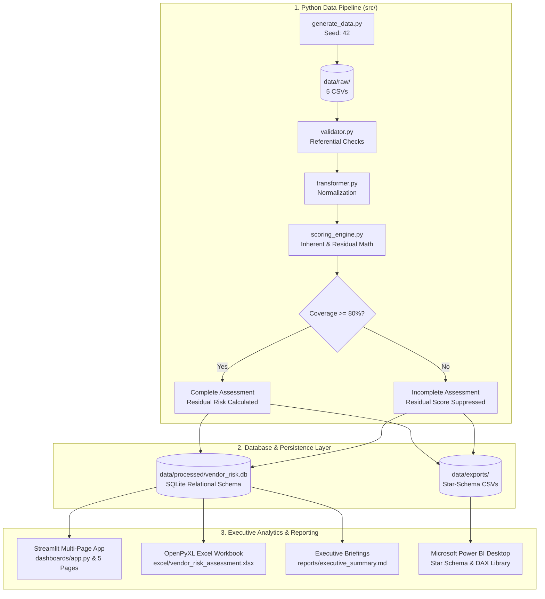

# Third-Party Cybersecurity Risk Assessment & GRC Analytics

[](https://www.python.org/)
[](https://www.sqlite.org/)
[](https://powerbi.microsoft.com/)
[](https://streamlit.io/)
[](https://www.nist.gov/cyberframework)
[-brightgreen?logo=pytest)](https://docs.pytest.org/)

An enterprise-grade, end-to-end **Third-Party Cybersecurity Risk Assessment and Governance, Risk, and Compliance (GRC) Analytics** platform built from the ground up.

Designed specifically to demonstrate practical, job-ready skills for **Technology Risk Analyst**, **GRC Analyst**, **IT Risk Analyst**, **IT Audit Analyst**, and **Cybersecurity Compliance Analyst** positions.

---

## 📑 Table of Contents
1. [Business Problem & Scenario](#1-business-problem--scenario)
2. [Project Technology Stack](#2-project-technology-stack)
3. [Architecture & Systems Design](#3-architecture--systems-design)
4. [The Five Core Datasets](#4-the-five-core-datasets)
5. [Risk-Scoring & Control Effectiveness Methodology](#5-risk-scoring--control-effectiveness-methodology)
6. [NIST Framework Alignment](#6-nist-framework-alignment)
7. [Installation & Quick Start](#7-installation--quick-start)
8. [Automated Testing & Quality Control](#8-automated-testing--quality-control)
9. [Interactive Streamlit Management Dashboard](#9-interactive-streamlit-management-dashboard)
10. [Power BI Data Model & DAX Library](#10-power-bi-data-model--dax-library)
11. [Professional Excel Workbook](#11-professional-excel-workbook)
12. [Executive Management Reporting](#12-executive-management-reporting)
13. [Interview Walkthrough & Key Talking Points](#13-interview-walkthrough--key-talking-points)
14. [Limitations & Assumptions](#14-limitations--assumptions)

---

## 1. Business Problem & Scenario

**ApexFin Technologies Inc.** is a fictional mid-sized financial technology and multi-tenant cloud SaaS organization with approximately 1,200 employees. ApexFin relies on an ecosystem of **25 external technology vendors** across critical business operations including:
- Multi-region cloud hosting (IaaS / PaaS)
- Credit card authorization and payment gateways
- 24/7 Managed Security Operations Centers (SOC / MDR)
- Customer Relationship Management (CRM) databases
- Offshore and onshore contract software development teams
- Human Resources Information Systems (HRIS) and payroll

### Executive Challenges Addressed:
1. **Gross Threat Identification:** Which third-party suppliers introduce the highest inherent exposure based on direct access, sensitive PII hosting, and sole-source dependencies?
2. **Control Efficacy:** Are vendors maintaining verified technical safeguards (MFA, PAM, Encryption, Incident Response)?
3. **Audit Blind Spots:** How do we prevent incomplete assessments from presenting a false sense of security?
4. **Residual Risk Modeling:** What is the net remaining risk post-controls, and how much "risk buy-down" has been achieved?
5. **Contractual SLA Accountability:** Which vendors are breaching Corrective Action Plan (CAP) remediation deadlines?

*Note: All vendor names, country designations, and assessment comments are entirely synthetic, reproducible, and created for educational/portfolio demonstration.*

---

## 2. Project Technology Stack

| Domain | Technology / Tool | Implementation Purpose |
| :--- | :--- | :--- |
| **Data Engineering** | **Python 3.12 (Pandas, NumPy)** | Deterministic synthetic generation, validation, normalization, and scoring engine. |
| **Relational Database** | **SQLite 3 + SQL DDL** | Relational schema with primary keys, foreign keys, check constraints, and 15 analytical queries. |
| **Interactive Dashboard** | **Streamlit + Plotly Express** | Enterprise 5-page GRC management dashboard with dynamic filtering and risk heatmaps. |
| **Business Intelligence** | **Microsoft Power BI Desktop** | Star-schema dimensional model, relational ERD, and production DAX measure library. |
| **Spreadsheet Modeling** | **Excel (OpenPyXL)** | 8-worksheet corporate workbook with formulas, freeze panes, and conditional formatting. |
| **Testing & Quality** | **Pytest** | Automated unit and integration test suite (12 test cases covering math, FKs, and SQL). |
| **Framework Standards** | **NIST CSF 2.0 & SP 800-161** | Control mappings, evidence tiers, and SP 1326 five due diligence dimensions. |

---

## 3. Architecture & Systems Design



---

## 4. The Five Core Datasets

All datasets maintain strict primary key / foreign key referential integrity:

1. **Vendor Inventory (`dim_vendors.csv`):** 25 vendors across 10 categories with criticality, data sensitivity, system access level, cloud tenancy, spend band, and baseline likelihood/impact.
2. **Cybersecurity Control Catalog (`dim_controls.csv`):** 25 controls across 25 distinct security domains, with assessment questions, audit evidence requirements, relative weights (1.0 to 3.0), and official NIST mappings.
3. **Vendor Assessment Responses (`fact_assessments.csv`):** 625 records ($25 \text{ vendors} \times 25 \text{ controls}$) tracking operational implementation and documentary evidence status.
4. **Risk Register (`fact_risk_register.csv`):** 198 actionable findings originating from control deficiencies or unverified evidence on high-weight controls.
5. **Remediation Tracker (`fact_remediation_tracker.csv`):** 198 Corrective Action Plans with assigned owners, priorities, due dates, completion dates, and SLA compliance tracking.

---

## 5. Risk-Scoring & Control Effectiveness Methodology

> [!IMPORTANT]
> This quantitative risk-scoring model is designed as an illustrative, transparent portfolio scoring methodology for enterprise Technology Risk demonstrations, not an official NIST-prescribed formula.

### A. Inherent Risk (Gross Exposure)
$$\text{Inherent Risk Score} = \text{Inherent Likelihood (1--5)} \times \text{Inherent Impact (1--5)}$$
- **Low:** 1–4 | **Moderate:** 5–9 | **High:** 10–16 | **Critical:** 17–25

### B. Evidence-Weighted Control Effectiveness
Controls receive an evidentiary score based on independent validation:
- **Implemented + Verified Evidence:** `1.00` (SOC 2 Type II, ISO 27001, Pen Test Report)
- **Implemented + Unverified Evidence:** `0.75` (Vendor self-attestation only)
- **Partially Implemented:** `0.50` (Procedural/manual exceptions observed)
- **Not Implemented:** `0.00` (Control absent; finding raised)
- **Not Applicable:** Excluded from calculation
- **Not Assessed:** Unanswered item penalized in Coverage calculation

$$\text{Control Effectiveness} = \frac{\sum_{\text{Assessed Applicable}} (\text{Item Score} \times \text{Weight})}{\sum_{\text{Assessed Applicable}} \text{Weight}}$$

### C. The 80% Assessment Coverage Rule
$$\text{Assessment Coverage} = \frac{\sum_{\text{Assessed Applicable}} \text{Weight}}{\sum_{\text{Total Applicable}} \text{Weight}}$$
- If **Coverage $\ge 80.0\%$**: The assessment is classified as **Complete**.
- If **Coverage $< 80.0\%$**: The assessment is marked as **Incomplete (<80% Coverage)**. The residual risk score is **suppressed (nullified)** to prevent premature approval based on partial questionnaire returns.

### D. Residual Risk (Net Exposure)
For assessments with at least 80% coverage:
$$\text{Residual Risk} = \max\left(1, \left\lceil \text{Inherent Risk} \times (1 - \text{Control Effectiveness}) \right\rceil\right)$$

---

## 6. NIST Framework Alignment

Our controls map to official publications without inventing artificial identifiers:
- **NIST CSF 2.0:** Aligned with **GV.SC (Cybersecurity Supply Chain Risk Management)**, `PR.AA` (Identity & Access), `PR.DS` (Data Security), `PR.PS` (Platform Security), `DE.CM` (Continuous Monitoring), and `RS.MA` (Incident Management).
- **NIST SP 800-161 Rev. 1 (Nov 2024 Update):** Mapped to control families `AC`, `IA`, `SC`, `SI`, `CP`, `IR`, and `SR`.
- **NIST SP 1326 Due Diligence Dimensions:**
  1. *Foreign Ownership, Control, or Influence (FOCI)*
  2. *Provenance (SBOM & CI/CD)*
  3. *Resilience (BCP/DR/Backups)*
  4. *Foundational Cyber Practices (MFA/PAM/Patching)*
  5. *Supply Chain Tiers (Subcontractor Flow-Downs)*

---

## 7. Installation & Quick Start

### Prerequisites
- Python 3.11 or Python 3.12
- Git

### 1. Clone & Setup Workspace
```bash
git clone https://github.com/your-username/third-party-cyber-risk-assessment.git
cd third-party-cyber-risk-assessment
```

### 2. Install Dependencies
```bash
pip install -r requirements.txt
```

### 3. Run the End-to-End Pipeline
Executes data generation, validation, scoring, SQLite loading, Excel export, and executive report creation in under 10 seconds:
```bash
python -m src.main
```

### 4. Launch the Streamlit GRC Dashboard
```bash
streamlit run dashboards/app.py
```
Open your browser to `http://localhost:8501`.

---

## 8. Automated Testing & Quality Control

The project includes an automated **Pytest** test suite verifying schema integrity, mathematical formulas, edge cases, and SQLite queries:

```bash
pytest -v
```

### Verified Test Cases (12/12 Passing):
- `test_vendor_record_count_and_uniqueness`
- `test_control_catalog_count_and_uniqueness`
- `test_assessment_responses_integrity`
- `test_risk_register_referential_integrity`
- `test_remediation_tracker_integrity`
- `test_sqlite_table_existence`
- `test_sqlite_record_counts`
- `test_sql_analysis_queries_execution` (Validates 15 analytical SQL queries)
- `test_control_item_scores`
- `test_risk_band_mapping`
- `test_residual_risk_math`
- `test_coverage_threshold_and_incomplete_handling`

---

## 9. Interactive Streamlit Management Dashboard

The dashboard provides a lightweight, corporate GRC user interface:
- **Landing Page (`dashboards/app.py`):** High-level KPI cards, gross vs. net risk comparisons, and vendor criticality distributions.
- **Page 1: Executive Overview (`1_Executive_Overview.py`):** Portfolio macro-metrics, risk reduction deltas, and incomplete assessment alerts.
- **Page 2: Vendor Risk Analysis (`2_Vendor_Risk_Analysis.py`):** Multi-attribute slicers (Criticality, Category, Risk Level), CSV export, and granular vendor profile inspector.
- **Page 3: Control Assessment (`3_Control_Assessment.py`):** Highest failure rate controls, evidence verification breakdowns, and NIST mapping catalog lookup.
- **Page 4: Risk Register (`4_Risk_Register.py`):** 5x5 Likelihood $\times$ Impact risk matrix, finding severity breakdowns, and owner filtering.
- **Page 5: Remediation Monitoring (`5_Remediation_Monitoring.py`):** Overdue SLA alerts, action item resolution progress, and internal owner workload balances.

---

## 10. Power BI Data Model & DAX Library

The Power BI data model follows a **Star-Schema Architecture** optimized for high-performance cross-filtering:
- Pre-exported clean CSVs available in `data/exports/` for one-click import into Power BI Desktop.
- Complete ERD and relationship instructions documented in [`powerbi/data_model.md`](powerbi/data_model.md).
- Reusable DAX measures library documented in [`powerbi/dax_measures.md`](powerbi/dax_measures.md).
- Detailed 4-page report construction guide documented in [`powerbi/dashboard_build_guide.md`](powerbi/dashboard_build_guide.md).

---

## 11. Professional Excel Workbook

Located at `excel/vendor_risk_assessment.xlsx`, this workbook contains **8 corporate-styled worksheets**:
1. **Executive Summary:** KPI blocks, distribution tables, and dynamic Excel formulas (`COUNTA`, `COUNTIF`).
2. **Vendor Inventory:** Full vendor inventory with scores, coverage, and residual tiers.
3. **Control Catalog:** 25 controls with descriptions, questions, and NIST mappings.
4. **Vendor Assessments:** 625 assessment records with soft conditional formatting.
5. **Risk Register:** Detailed findings with severity levels and recommended mitigations.
6. **Remediation Tracker:** Action items with priorities, SLAs, and overdue highlights.
7. **Risk Scoring Methodology:** Formulas, scoring tables, and governance rules.
8. **Data Dictionary:** Schema specifications, constraints, and descriptions.

---

## 12. Executive Management Reporting

Two dynamic, data-driven reports are generated under `reports/`:
- **[`reports/executive_summary.md`](reports/executive_summary.md):** High-level board briefing for CISO / CRO summarizing portfolio risk buy-down, high-exposure vendors, and critical action plans.
- **[`reports/risk_assessment_report.md`](reports/risk_assessment_report.md):** Comprehensive technical audit report with control failure statistics and supply chain resilience recommendations.

---

## 13. Interview Walkthrough & Key Talking Points

Preparing for a Technology Risk or GRC Analyst interview? Refer to [`docs/interview_questions.md`](docs/interview_questions.md) for **22 technical and scenario-based Q&As**.

### 30-Second Elevator Pitch:
> "I built an end-to-end third-party cybersecurity risk analytics platform that evaluates 25 technology vendors across 25 standardized security controls aligned with NIST CSF 2.0 and NIST SP 800-161. Rather than relying on disconnected spreadsheets, the platform automates data validation, enforces an 80% assessment coverage rule to eliminate false security assurance, calculates quantitative residual risk buy-down, and serves insights through SQLite, Streamlit, Power BI, and automated Excel workbooks."

---

## 14. Limitations & Assumptions
- **Point-in-Time Evaluations:** Traditional assessments reflect a point in time; mature programs should pair questionnaires with continuous security rating services (TPCM).
- **Self-Attestation Penalties:** The model applies a 25% penalty on unverified vendor assertions.
- Complete limitations and methodological assumptions are documented in [`docs/limitations.md`](docs/limitations.md).

---
*Developed by Nishant for Technology Risk, IT Audit, Cybersecurity Compliance, and GRC Analyst portfolios.*

